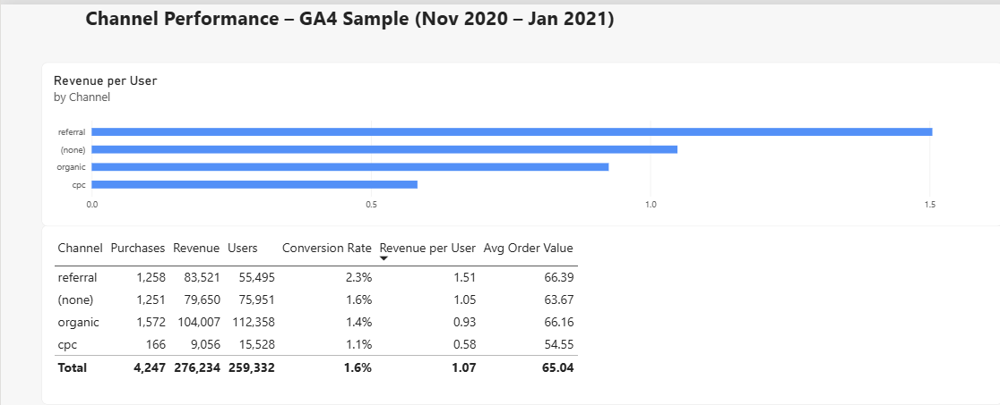

# ga4-bigquery-portfolio

SQL analysis of GA4 e-commerce sample data in BigQuery, with dashboards in Data Studio and Power BI.

## Objective

I wanted to determine the number of unique users in January 2021. I compared the number of unique users for each day (aggregated monthly data) with the total number of unique users for the entire month. I also wanted to count all sessions and build a purchase funnel to find out where people drop off. Then, I ran a cohort analysis to find out whether users come back in the months after their first visit. Finally, I compared customer acquisition channels by conversion rate and revenue per user to determine which was the most effective.

## Data

I used data from the public dataset `bigquery-public-data.ga4_obfuscated_sample_ecommerce.events_*` (for the Google Merchandise Store) for January 2021. The cohort and channel analyses use the full available period, from November 1, 2020 to January 31, 2021. This data may differ from actual metrics, as it only simulates real-world statistics.

## Queries

- `01_january_unique_users_by_day.sql` — calculating the number of unique users for each day in January.
- `02_january_unique_users_total.sql` — counting the total number of unique users for the entire month (accounting for deduplication across the full period).
- `03_january_sum_of_daily_users.sql` — summing the unique user counts for each day in January to check if the simple sum of daily figures matches the total monthly value.
- `04_january_sessions_total.sql` — counts the total number of unique sessions in January 2021 (session = `user_pseudo_id` + `ga_session_id`).
- `05_january_funnel_sessions.sql` — counts unique sessions for each funnel event.
- `06_january_funnel_steps.sql` — assigns a step number to each funnel event with `CASE WHEN` to set the funnel order.
- `07_january_funnel_conversion.sql` — calculates step-to-step conversion rate using `LAG` (current step / previous step, shown as % in Data Studio).
- `08_first_visit_by_user.sql` — first visit date for each user across the whole dataset.
- `09_cohort_by_user.sql` — assigns each user to a cohort by the month of their first visit.
- `10_cohort_size.sql` — number of users in each cohort.
- `11_activity_by_user.sql` — months in which each user was active (one row per user + month).
- `12_cohort_activity.sql` — joins activity with cohorts and calculates `month_number` (months since first visit).
- `13_cohort_retention.sql` — number of active users per cohort and `month_number`. The query calculates cohort size and retention rate (as a proportion of the cohort size), in addition to user counts.
- `14_channel_performance.sql` — calculates users, purchases, revenue, conversion rate, average order value, and revenue per user broken down by each traffic source medium (`traffic_source.medium`).
  
## Dashboard

[Purchase Funnel – January 2021](https://datastudio.google.com/reporting/3790c61f-8a3c-4a72-ae93-840c8d1c7ec3) — interactive dashboard in Data Studio.

**Channel Performance (Power BI)** — compares traffic channels by purchases, revenue, conversion rate, average order value and revenue per user. Ratio metrics are calculated with DAX measures, so totals are correct instead of being a sum of percentages. The `.pbix` file is in the [`powerbi`](powerbi/) folder.

 
## Key Findings
### Users: daily vs monthly
The sum of unique users by day (106,565) exceeds the total number of unique users for the month (94,790) because returning visitors were counted multiple times in the daily statistics. On average, each active user visited the store on **1.12 different days** in January (106,565 / 94,790), indicating a high proportion of one-time site visits within the month. 
**Important analytical insight:** You cannot simply sum the number of unique users across individual days to calculate weekly or monthly metrics, as this leads to inflated figures due to the double-counting of the same visitors. To obtain accurate aggregate data for a given period, you must calculate unique users based on the entire time interval. Note that `user_pseudo_id` identifies a specific device or browser rather than an individual person; consequently, the same user accessing the service from different devices will be counted separately.
### Purchase funnel
| Step | Event | Sessions | Step conversion |
|---|---|---|---|
| 1 | session_start | 116,514 | — |
| 2 | view_item | 23,105 | 19.8% |
| 3 | add_to_cart | 4,537 | 19.6% |
| 4 | begin_checkout | 2,159 | 47.6% |
| 5 | add_shipping_info | 2,159 | 100% |
| 6 | add_payment_info | 1,560 | 72.3% |
| 7 | purchase | 1,115 | 71.5% |

The biggest drop-off happens on the product page: 80.4% of sessions (18,568 out of 23,105) end before users add something to the cart — only 19.6% (4,537 out of 23,105) move forward. This step is critical because product viewers already show interest in the product, so it is easier to convert them than random site visitors. Meanwhile, checkout works well: 51.6% (1,115 out of 2,159) convert from begin_checkout to purchase, showing that the main problem is before checkout. We should focus on the product page and check key elements: pricing, product photos, customer reviews, and shipping costs.

### Cohort retention

**What was measured:** The percentage of users who returned and were active in Month 1 or Month 2 after their initial acquisition month.

| Cohort | Users | Month 1 | Month 2 |
|---|---|---|---|
| 2020-11 | 79,421 | 4,651 (5.9%) | 1,204 (1.5%) |
| 2020-12 | 99,664 | 2,517 (2.5%) | – |
| 2021-01 | 91,069 | – | – |

*Data for Month 1 and Month 2 is unavailable for later cohorts because the dataset ends on January 31, 2021.*

**Key finding:** Overall user retention is low across observed cohorts, with fewer than 6% of users returning in the first month after their initial visit (based on November and December data).

**Cohort comparison:** Retention dropped significantly for the December cohort, with Month 1 retention falling to 2.5% compared to 5.9% for the November cohort. *Hypothesis:* The surge in December traffic may have brought lower-intent seasonal visitors or promotional campaign traffic with poor long-term retention.

**Limitations:**
- **`user_pseudo_id` usage:** Retention is tracked using client device identifiers rather than authenticated user accounts, which may artificially lower calculated retention if users clear cookies or switch devices.
- **Cohort contamination (November):** The dataset begins on November 1, 2020. Without prior historical data, returning users from earlier months may be misclassified as new users in the November cohort, potentially inflating its retention rates.
- **Short observation period:** The 3-month timeframe limits the ability to observe long-term retention trends or seasonal recovery patterns.

### Channel performance

**What was measured:** I compared traffic channels grouped by `traffic_source.medium` to evaluate their performance in driving user volume, conversion rates, and overall monetary value generated during November 1, 2020 – January 31, 2021.
The same metrics are calculated as DAX measures in Power BI, so the Total reflects the correct value instead of summing the shares.

| Channel | Users | Purchases | Revenue ($) | Conversion rate | Avg order value ($) | Revenue per user ($) |
|---|---|---|---|---|---|---|
| referral | 55,495 | 1,258 | 83,521 | 2.3% | 66.39 | 1.51 |
| (none) | 75,951 | 1,251 | 79,650 | 1.6% | 63.67 | 1.05 |
| organic | 112,358 | 1,572 | 104,007 | 1.4% | 66.16 | 0.93 |
| cpc | 15,528 | 166 | 9,056 | 1.1% | 54.55 | 0.58 |

- `referral` — traffic from links on external websites.
- `(none)` — direct traffic (typed URL, bookmarks, or unknown sources).
- `organic` — unpaid traffic from search engine results.
- `cpc` — paid ads (cost per click).

**Key findings:**
- **Paid traffic (`cpc`) is the weakest channel on every metric:** conversion rate 1.1%, average order value $54.55 and revenue per user $0.58 – about 2.6 times lower than `referral` ($1.51).
- **`referral` is the strongest channel:** it has the highest conversion rate (2.3%), the highest average order value ($66.39) and the highest revenue per user ($1.51).
- **`organic` brings the most revenue in total ($104,007), but through volume, not efficiency:** with the largest audience (112,358 users), it earns only $0.93 per user – less than `referral` and `(none)`.

**Limitations:**
- **No advertising cost data:** GA4 does not include ad spend, so return on ad spend (ROAS = revenue / ad spend) cannot be calculated. Whether `cpc` is profitable can only be judged by comparing its $9,056 in revenue with the costs in Google Ads.
- **Users overlap between channels:** the sum of users across channels (328,574) is higher than the total number of users in the dataset (270,154), so channel shares do not add up to 100%. `traffic_source` should describe the first acquisition channel per user, so the overlap is likely a result of the dataset's obfuscation.
- **Obfuscated values:** `<Other>` (51,038 users) and `(data deleted)` (18,204 users) are artifacts of the anonymised sample dataset, not real channels, and are excluded from the table and findings.
  

